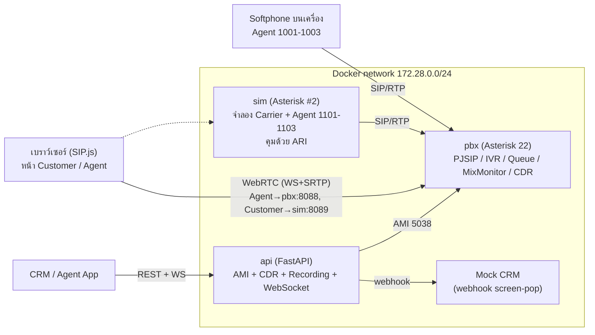
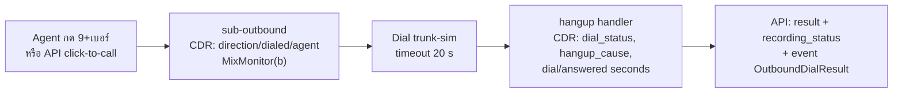

# Asterisk Call Center POC

POC ประเมิน Asterisk 22 LTS เป็น Core Telephony / Call Center Platform

Flow ที่ทดสอบ:

- **Inbound**: `Customer Call → IVR → Select Service → Queue → Agent Answer → Hold/Transfer → End Call → Recording + CDR`
- **Outbound**: `Agent กด 9+เบอร์ (หรือ API click-to-call) → Trunk/Carrier → ผลสาย (ติด / ไม่ติด + สาเหตุ) → Recording status + CDR`

## สถาปัตยกรรม



| ส่วน | ที่อยู่ |
|---|---|
| Config PBX | [asterisk/etc](asterisk/etc) (`pjsip.conf`, `extensions.conf`, `queues.conf`, `cdr_sqlite3_custom.conf`, ...) |
| Config ตัวจำลอง | [sim/etc](sim/etc) |
| Integration API | [api/app](api/app) |
| หน้าจอ Demo (แยก 5 หน้า) | [api/app/static](api/app/static) (`customer / agent / dashboard / transactions / flow .html`) + [api/app/demo.py](api/app/demo.py) |
| Softphone WebRTC (SIP.js) | [api/app/static/softphone.js](api/app/static/softphone.js) + [vendor/sip-0.21.2.min.js](api/app/static/vendor) (vendored, ไม่ต้องมี Node) |
| Timeline ของแต่ละสาย (transactions) | [api/app/timeline.py](api/app/timeline.py) (SQLite `/data/timeline.db`) |
| เพิ่ม/ลบ Agent runtime | [api/app/agents_admin.py](api/app/agents_admin.py) (เขียน `pjsip_agents.conf` ให้ PBX) |
| E2E test | [tests/e2e.py](tests/e2e.py) |
| ผลการประเมิน / Gap | [docs/POC-REPORT.md](docs/POC-REPORT.md) |
| แนวคิดพื้นฐาน (ภาษาไทย) | [docs/CALL-CENTER.md](docs/CALL-CENTER.md) |
| แผนภาพ: ที่ทำแล้ว vs ต้องทำเพิ่ม | [docs/ARCHITECTURE.md](docs/ARCHITECTURE.md) |

## วิธีรัน

ต้องมี Docker (compose v2)

```bash
docker compose up -d --build     # ครั้งแรก build Asterisk จาก source ประมาณ 10-20 นาที
docker compose logs -f pbx       # ดู log
docker compose exec pbx asterisk -rvvv    # Asterisk CLI
```

หมายเหตุ

- ไฟล์ใน [asterisk/etc](asterisk/etc) และ [sim/etc](sim/etc) ถูก copy เข้า container ตอน start เท่านั้น แก้แล้วต้อง `docker compose restart pbx` (ไม่ใช่ `dialplan reload`)
- ถ้าแก้ column ของ CDR ([cdr_sqlite3_custom.conf](asterisk/etc/cdr_sqlite3_custom.conf)) ต้อง `docker compose down -v` เพื่อสร้างตาราง CDR ใหม่ (ข้อมูล CDR/recording ใน volume จะหายด้วย)
- ถ้าเครื่องอยู่หลัง proxy ที่ทำ TLS inspection: export CA ของ proxy เป็นไฟล์ `.crt` ใส่ใน `asterisk/certs/` และ `api/certs/` ก่อน build (โฟลเดอร์นี้ถูก gitignore ไว้)

รัน E2E อัตโนมัติ (ใช้ agent/customer จำลองผ่าน SIP จริง):

```bash
docker compose --profile test run --rm e2e                    # ทุก scenario S0-S10 (~6 นาที)
docker compose --profile test run --rm -e ONLY=s7 e2e         # เฉพาะบาง scenario เช่น ONLY=s1,s7
```

| Scenario | ทดสอบ |
|---|---|
| S0 | SIP registration, agent login เข้า Queue |
| S1 | IVR → Queue → Agent รับ → Hold/Unhold → วางสาย → CDR + Recording + CRM screen-pop |
| S2 | กระจายสายระหว่าง agent (leastrecent) |
| S3 | Transfer agent → agent และ agent → queue (ผ่าน API) ได้ recording ไฟล์เดียว |
| S4 | Abandon, ไม่มี agent ว่าง |
| S5 | Click-to-call agent → agent |
| S6 | กด IVR ผิดแล้วกดใหม่ |
| S7 | **Outbound**: ติด / สายไม่ว่าง / ไม่รับ / ล้มเหลว / agent ยกเลิก + recording status |
| S8 | หน้า Transactions: IVR digit, คิว, Agent, จุดที่โอนสายไป (from → to) |
| S9 | เพิ่ม / ลบ Agent ตอนรันไทม์ (PJSIP endpoint + สมาชิกทั้ง 6 คิว) |
| S10 | ลูกค้าโทรเข้าพร้อมกัน 3 สาย → ถึง 3 Agent คนละคน |

API docs (Swagger): http://localhost:8000/docs — ทุก endpoint ต้องมี header `X-API-Key: poc-api-key`

## หน้าจอ Demo (สำหรับนำเสนอผู้บริหาร)

เปิด http://localhost:8000/demo (หน้า hub) — แยกเป็น 5 หน้า เปิดคนละแท็บ/คนละเครื่องได้

| หน้า | URL | ใช้ทำอะไร |
|---|---|---|
| ลูกค้า | `/demo/customer` | **แป้นกดเบอร์อย่างเดียว** (เหมือนมือถือ) หมุน 1484 → ฟังเสียง IVR → กดเลือกเมนู 1-6 ระหว่างสาย; ถ้า Agent โทรออกมาจะเห็นสายเรียกเข้าและกดรับ/ปฏิเสธได้จริง |
| Agent | `/demo/agent` | สถานะ (พร้อม / พัก / ออก), รับ/ปฏิเสธ/Hold/โอน/วางสาย, **ปุ่มโทรออก** (กรอกเบอร์หรือเลือกลูกค้าที่ออนไลน์) + chip ผลสาย |
| Dashboard | `/demo/dashboard` | KPI, สถานะ Agent (**เพิ่ม/ลบ Agent**), คิว, สายสด, event สด, สวิตช์โหมด, ปุ่มจำลอง **ลูกค้าโทรพร้อมกัน N สาย** |
| Transactions | `/demo/transactions` | รายการสายทั้งหมด + timeline ละเอียดทุกขั้น (ใครคุยกับใคร module ไหน → module ไหน), **โอนไปที่ไหน**, ผลโทรออก, ไฟล์ recording |
| Flow Map | `/demo/flow` | diagram ว่าแต่ละขั้นอยู่ module ไหนและคุยกับ module ไหนอย่างไร (เส้นกะพริบสดตาม event) |

**2 โหมดการโทร** (สวิตช์บนหน้า Customer / Agent)

- **จริง (WebRTC)**: เบราว์เซอร์ลงทะเบียนเป็น SIP endpoint ผ่าน SIP.js ใช้ไมค์/ลำโพงจริง — Agent เว็บ (ext 12xx) ลงทะเบียนที่ pbx `ws://localhost:8088/ws`, ลูกค้า (เบอร์ `0800000001`-`0800000020` เลือกให้อัตโนมัติ) ลงทะเบียนที่ตัวจำลอง Carrier `ws://localhost:8089/ws` แล้วโทรผ่าน trunk เข้า pbx เหมือนโทรเข้าเลขหมาย 1484 จริง
- **จำลอง**: ไม่ใช้ไมค์ ระบบจำลองลูกค้าและ Agent 1101-1103 ผ่าน ARI; หน้า Customer เล่นไฟล์เสียง IVR จริง (`/static/ivr/*.wav`) ตาม event ของ IVR

**เมนู IVR 1484 (เมืองไทยประกันภัย)** — เสียงไทยจาก neural TTS (`asterisk/tools_gen_neural.py` → `asterisk/prompts/*.wav`; สำรองด้วย espeak-ng ใน `gen-prompts.sh`) — ระบบจริงควรใช้เสียงอัดจากผู้ประกาศ

| กด | บริการ | คิว |
|---|---|---|
| 1 | แจ้งอุบัติเหตุ (24 ชม.) | `q-accident` |
| 2 | แจ้งเหตุอื่น ๆ | `q-incident` |
| 3 | สอบถามประกันรถยนต์ | `q-motor` |
| 4 | สอบถามประกันอื่น ๆ | `q-insurance` |
| 5 | ซื้อประกัน | `q-sales` |
| 6 | เมืองไทย เฟรนด์สคลับ | `q-club` |

**โหมดควบคุม** (Dashboard): *กดเอง* — ผู้นำเสนอกดทีละขั้น (Agent จำลองเรียกเข้าค้างจนกด รับ/ปฏิเสธ); *อัตโนมัติ* — ลูกค้ากดเมนูเอง และ Agent จำลองรับสายเองหลัง ~3 วินาที (`DEMO_ANSWER_DELAY`)

**Outbound แบบจริง**: Agent กรอกเบอร์ลูกค้าที่ออนไลน์ (เช่น `0800000001`) → PBX โทรหา Agent ก่อน (Agent เว็บรับสายอัตโนมัติ) → โทรออกผ่าน trunk ไปหน้าจอลูกค้า → ลูกค้ากดรับ = `CONNECTED`, ปฏิเสธ = `BUSY`, ไม่รับ 20 วินาที = `NO_ANSWER`; ถ้าไม่มีลูกค้าออนไลน์ใช้เบอร์ทดสอบ `09xxxxxxxx` ตามตารางด้านล่าง

**สคริปต์นำเสนอ**: เปิด Customer + Agent + Dashboard + Transactions → ลูกค้าหมุน 1484 → ฟังเมนู → กด 3 → Agent รับสาย (Dashboard/Flow เห็นสายเดินตามขั้น) → Hold → โอนไป `q-accident` → วางสาย → เปิด Transactions ดู timeline + จุดที่โอน + ไฟล์เสียง → Agent โทรออกหาลูกค้า → ลูกค้ากดรับ/ปฏิเสธ → ดูผลสายและ recording status

หมายเหตุ

- WebRTC ต้องเปิดหน้าจาก `localhost` (หรือ HTTPS) เพื่อให้เบราว์เซอร์อนุญาตไมค์ และ media ผ่าน Docker NAT ใช้ ICE host candidate (`HOST_MEDIA_ADDR`, port RTP 10000-10100 และ 12000-12100/udp)
- ตัวจำลองเป็น ARI client ของ Stasis app `sim` ได้เพียงตัวเดียว: E2E จะสั่ง `POST /demo/disable` ก่อนเริ่ม (หลังรัน E2E ต้องกด "เริ่ม Demo" ใหม่)
- State ของ demo (pool ลูกค้า, โหมด) อยู่ใน memory; timeline และ registry ของ Agent อยู่ใน volume `api-data` (อยู่รอดหลัง restart)
- เปิดหน้าด้วย key อื่นได้ด้วย `?api_key=...` (ค่าเริ่มต้น `poc-api-key`)
- เพิ่ม/ลบ Agent ผ่าน API: `POST /demo/agents` (`{"name":"..."}` → ext 1201-1299 + login ทุกคิว), `DELETE /demo/agents/{ext}`; รายการสาย: `GET /transactions`, `GET /transactions/{call_id}`

## ทดสอบด้วย Softphone จริง (Zoiper / Linphone / MicroSIP)

| ค่า | Agent 1 | Agent 2 | Agent 3 |
|---|---|---|---|
| Username | 1001 | 1002 | 1003 |
| Password | poc-1001 | poc-1002 | poc-1003 |
| Domain / Proxy | `127.0.0.1:5060` UDP | | |

- โทรจาก softphone ไป `1484` = เข้า IVR (กด 1-6 ตามตารางเมนู IVR ด้านบน)
- `*45` login เข้าทุก Queue, `*46` logout, `*47` pause, `*48` unpause
- `600` echo test, `601` เล่นเสียงทดสอบ, `1001-1003` โทรหากัน
- **โทรออก (outbound)**: กด `9` + เบอร์ปลายทาง (อย่างน้อย 9 หลัก) เช่น `90900000001` — ดูหัวข้อ Outbound ด้านล่าง
- Hold / Transfer ใช้ปุ่มของ softphone (re-INVITE / REFER) หรือ `#` blind transfer, `*2` attended transfer ระหว่างสาย Queue
- ใช้ softphone บนเครื่องอื่นใน LAN: `BIND_ADDR=0.0.0.0 HOST_MEDIA_ADDR=<LAN IP ของเครื่องนี้> docker compose up -d`

> Port RTP 10000-10050/udp ถูก publish ผ่าน Docker NAT จึงตั้ง `media_address` ให้ endpoint 1001-1003 (ดู [pjsip.conf](asterisk/etc/pjsip.conf)) — บน server จริงไม่จำเป็น

## Outbound Call + สถานะผลสาย / Recording

POC ใช้ "Carrier จำลอง" (container `sim`) ผ่าน trunk `trunk-sim` — ไม่ได้ทดสอบกับ SIP trunk ของผู้ให้บริการจริง



### เบอร์ทดสอบ (Carrier จำลอง เลือกผลจาก **หลักสุดท้าย** ของเบอร์ `09xxxxxxxx`)

| เบอร์ตัวอย่าง | พฤติกรรมของ Carrier | `dial_status` | `result` | `recording_status` |
|---|---|---|---|---|
| `0900000001` | รับสาย + คุย | ANSWER | CONNECTED | recorded |
| `0900000006` | รับสาย แล้วปลายทางวางเอง ~6 วินาที | ANSWER | CONNECTED | recorded |
| `0900000002` | สายไม่ว่าง (486 Busy) | BUSY | BUSY | not_recorded |
| `0900000003` | ดัง ไม่มีคนรับ (ตัด 20 วินาที) | NOANSWER | NO_ANSWER | not_recorded |
| `0900000004` | Congestion (ระบบเครือข่ายเต็ม) | CONGESTION | FAILED | not_recorded |
| `0900000005` | เบอร์ไม่มีในระบบ (cause 1) | CHANUNAVAIL | FAILED | not_recorded |
| (Agent วางระหว่างรอดัง) | — | CANCEL | CANCELLED | not_recorded |

วิธีทดสอบ: ลงทะเบียน softphone เป็น 1001 แล้วโทร `90900000001`, `90900000002`, ... หรือเรียก API ด้านล่าง

```bash
H='X-API-Key: poc-api-key'
# click-to-call: PBX โทรหา agent ก่อน เมื่อ agent รับ จึงโทรออกไปเบอร์ลูกค้า (เบอร์ > 4 หลักจะเติมนำหน้า 9 ให้เอง)
curl -H "$H" -X POST localhost:8000/calls/originate -H 'content-type: application/json' \
     -d '{"agent":"1001","destination":"0900000002"}'
curl -H "$H" localhost:8000/calls/outbound                       # รายการโทรออกทั้งหมด + result + recording_status
curl -H "$H" 'localhost:8000/calls/outbound?result=NO_ANSWER'    # CONNECTED|BUSY|NO_ANSWER|CANCELLED|FAILED
curl -H "$H" 'localhost:8000/calls/outbound?agent=1001&dialed=0900000002'
curl -H "$H" 'localhost:8000/calls/history?direction=outbound'
curl -H "$H" 'localhost:8000/events?event=OutboundDialResult'     # ผลสายแบบ real-time (ผ่าน WebSocket /ws/events ด้วย)
```

ตัวอย่าง 1 แถวของ `/calls/outbound`

```json
{"call_id":"1792036733.41","direction":"outbound","agent":"1101","dialed":"0900000001",
 "result":"CONNECTED","dial_status":"ANSWER","hangup_cause":"16","hangup_cause_text":"normal clearing",
 "ring_seconds":0,"talk_seconds":6,"recording":"2026/10/15/1792036733.41-0900000001.wav","recording_status":"recorded"}
```

ความหมายของค่า

- `result` — สรุปผลสายสำหรับ UI/รายงาน: `CONNECTED` (ปลายทางรับสาย) / `BUSY` / `NO_ANSWER` / `CANCELLED` (agent วางก่อนปลายทางรับ) / `FAILED` (congestion, เบอร์ไม่มี, trunk ใช้ไม่ได้ ฯลฯ — ดูรายละเอียดที่ `dial_status` + `hangup_cause`/`hangup_cause_text` ซึ่งเป็นรหัส Q.850)
- `recording_status` — `recorded` เฉพาะเมื่อไฟล์ WAV มีอยู่จริงและมีเสียง (> 44 byte) มิฉะนั้น `not_recorded` เพราะ MixMonitor option `b` บันทึกเฉพาะช่วงที่สายถูก bridge (สายที่ไม่ติดจึงไม่มีไฟล์ — ตั้งใจ)
- `ring_seconds` / `talk_seconds` — วัดจากตอน Dial เริ่มจน Carrier ตอบ / ช่วงคุย (เฉพาะสายโทรออก)
- Asterisk ไม่ได้บันทึก early media (เสียงรอสาย/IVR ของปลายทางก่อนรับสาย) — ถ้าต้องการต้องพัฒนาเพิ่ม

สิ่งที่ **อยู่นอก scope** ของ POC นี้: auto-dialer / predictive-progressive campaign, call list, ข้อจำกัดสิทธิ์/Number plan ตามประเภทเบอร์ (ดู gap ใน [docs/POC-REPORT.md](docs/POC-REPORT.md))

## ตัวอย่าง API

```bash
H='X-API-Key: poc-api-key'
curl -H "$H" localhost:8000/monitor/summary          # สถานะรวม Call / Queue / Agent
curl -H "$H" localhost:8000/agents                   # Agent: registered, in-call, paused
curl -H "$H" localhost:8000/queues                   # สมาชิก, ผู้โทรที่รอ, abandoned
curl -H "$H" localhost:8000/calls/active
curl -H "$H" -X POST localhost:8000/agents/1001/login
curl -H "$H" -X POST 'localhost:8000/agents/1001/pause?paused=true&reason=lunch'
curl -H "$H" -X POST localhost:8000/agents/1001/transfer -H 'content-type: application/json' -d '{"target":"q-motor"}'
curl -H "$H" -X POST localhost:8000/calls/originate -H 'content-type: application/json' -d '{"agent":"1001","destination":"1002"}'   # click-to-call (เบอร์ภายนอกดูหัวข้อ Outbound)
curl -H "$H" localhost:8000/calls/history            # 1 แถวต่อ 1 สาย (IVR, queue, agent, wait/talk, result, recording)
curl -H "$H" 'localhost:8000/cdr?src=0811111111'     # CDR ดิบ
curl -H "$H" localhost:8000/recordings
curl -H "$H" -o call.wav localhost:8000/recordings/2026/10/15/<file>.wav
curl -H "$H" localhost:8000/queue-log
# real-time events:  ws://localhost:8000/ws/events?api_key=poc-api-key
```

ARI (REST + WebSocket ของ Asterisk เอง): `http://localhost:8088/ari/api-docs/resources.json` (user `poc` / `poc-ari-secret`)

## หมายเหตุด้านความปลอดภัย

รหัสผ่านทั้งหมดเป็นค่า lab เท่านั้น port ทั้งหมด bind `127.0.0.1` โดย default
ก่อนใช้งานจริงต้องเปลี่ยน credential, เปิด TLS/SRTP, จำกัด AMI/ARI ตาม network และใช้ auth จริงสำหรับ API
