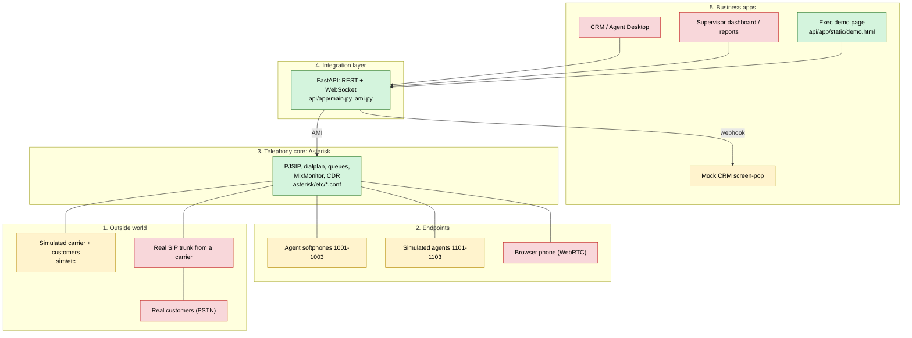
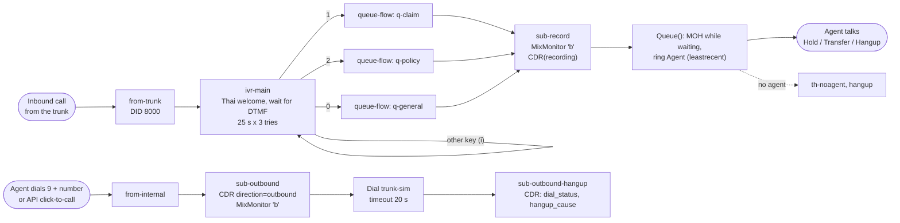
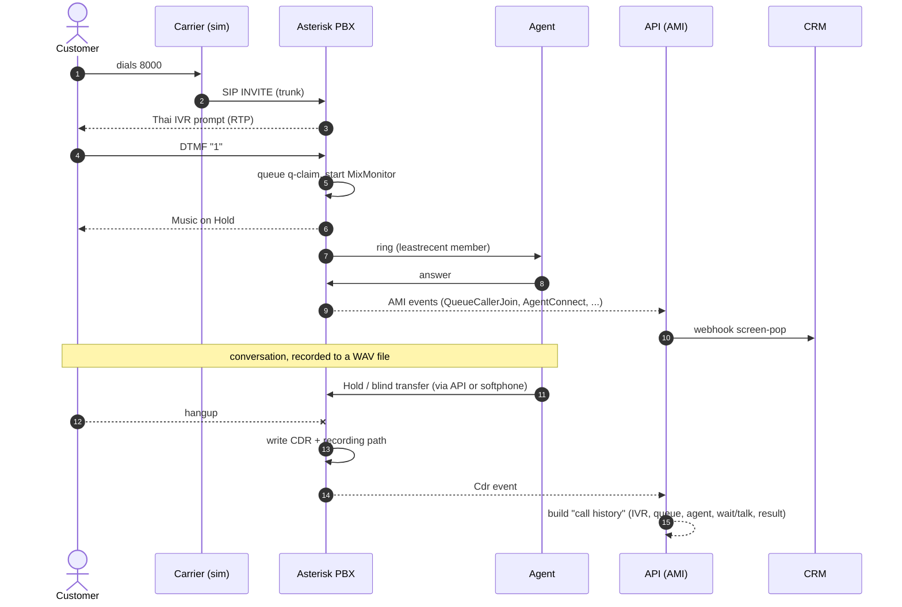
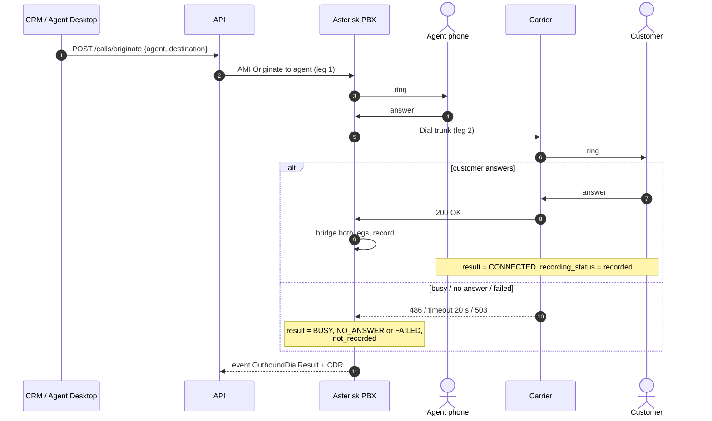
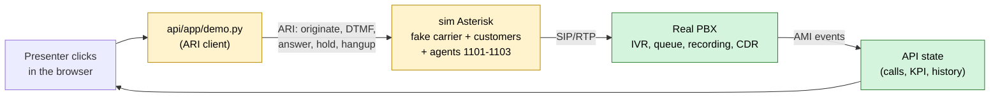
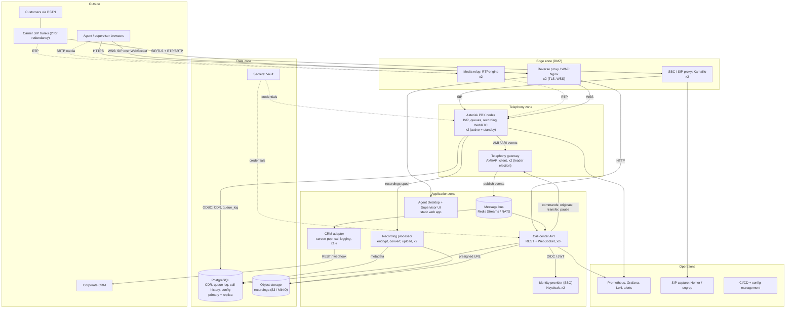
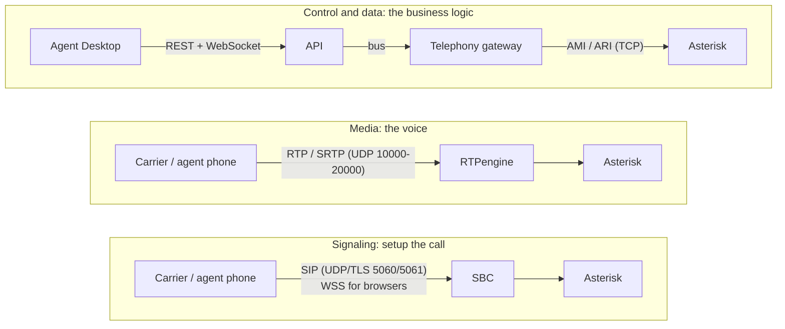
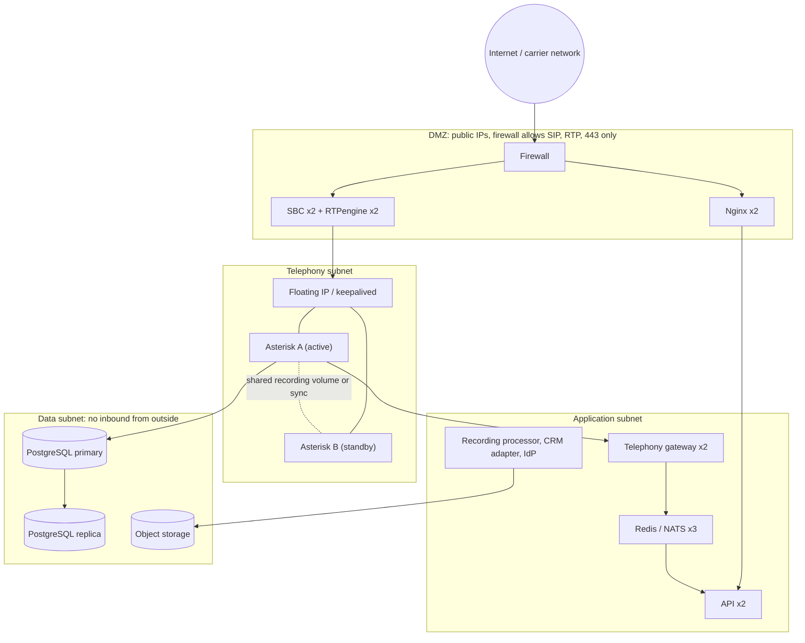
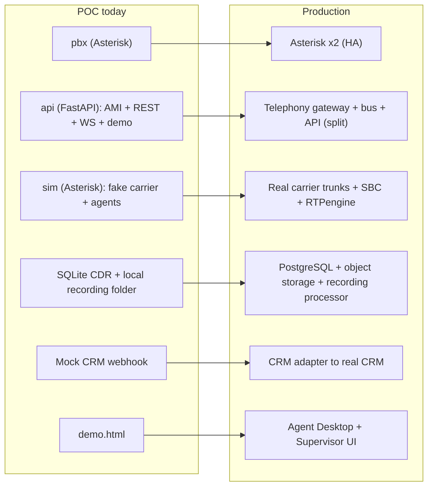

# Architecture Diagrams: Implemented vs. To Build

Companion to [CALL-CENTER.md](CALL-CENTER.md) (concepts, Thai) and [POC-REPORT.md](POC-REPORT.md) (evaluation).

Legend: **green** = implemented in this POC, **yellow** = simulated in the POC and must be replaced or set up for production, **red** = not built.

## 1. System layers

## 2. Dialplan map: where each call goes

Core of [asterisk/etc/extensions.conf](../asterisk/etc/extensions.conf). Each box is a context (a named group of rules).

Also in `from-internal`: `*45` / `*46` / `*47` / `*48` = queue login / logout / pause / unpause, `600` / `601` = echo and test tone, `1XXX` = agent to agent.

## 3. Sequence: one inbound call end to end

## 4. Sequence: click-to-call (outbound)

## 5. What the demo page does

Only the people are fake (customer, carrier, agents). The PBX behaviour shown (IVR, queue, hold, transfer, CDR, events) comes from the real Asterisk.

## 6. Checklist

### A. Implemented in this POC

| Capability | Where |
|---|---|
| SIP endpoints, trunk, NAT/RTP settings | [pjsip.conf](../asterisk/etc/pjsip.conf), [rtp.conf](../asterisk/etc/rtp.conf) |
| IVR (Thai prompts, DTMF, retry/invalid/repeat) | `ivr-main` in [extensions.conf](../asterisk/etc/extensions.conf) |
| Queues (3 skills, leastrecent) and hold music | [queues.conf](../asterisk/etc/queues.conf), [musiconhold.conf](../asterisk/etc/musiconhold.conf) |
| Recording (inbound and outbound) | `sub-record` + `MixMonitor(b)` |
| CDR with custom fields (IVR choice, agent, recording, dial status) | [cdr_sqlite3_custom.conf](../asterisk/etc/cdr_sqlite3_custom.conf) |
| Outbound with result classification | `sub-outbound`, `sub-outbound-hangup` |
| API: agents, queues, active calls, history, CDR, recordings, events (REST + WebSocket) | [api/app](../api/app) |
| Agent actions via API: login, logout, pause, transfer, hangup, click-to-call | [main.py](../api/app/main.py) |
| CRM screen-pop webhook (mock) | `/mock-crm/screenpop` |
| Exec demo page | [demo.html](../api/app/static/demo.html), [demo.py](../api/app/demo.py) |
| Automated tests (42 checks, scenarios S0 to S7) | [tests/e2e.py](../tests/e2e.py) |

### B. Simulated now: create or configure for production

| Item | What to do |
|---|---|
| SIP trunk | Replace `trunk-sim` with the carrier's trunk in `pjsip.conf`: credentials or IP auth, codecs, DID mapping in `from-trunk`, outbound prefix and caller ID rules. |
| Agent phones | Decide: softphone, desk phone or WebRTC. Create real endpoints and credentials per agent. |
| Network | Public IP/NAT (`media_address`, `external_*`), firewall for 5060 and the RTP range, SBC if needed. |
| Security | Change all lab passwords, use TLS/SRTP, lock down AMI/ARI, real API authentication (JWT/SSO). |
| Database | CDR is SQLite on a volume. Move to PostgreSQL/MySQL with backups. |
| Recording storage | Shared or object storage, retention, encryption, access audit, PDPA rules. |
| CRM integration | Replace the mock webhook with the real CRM API. |
| Prompts and hold music | Professional Thai prompts and real MOH (current ones are POC-generated). |
| Business rules | Real queue strategy, SLA, business hours, holiday routing, overflow and timeout behaviour. |
| Transfer rules | `POST /agents/{ext}/transfer` does a direct blind transfer and ignores agent pause state. Add a state check or transfer through queues. |

### C. Not built (gaps for the report)

| Gap | Note |
|---|---|
| Agent Desktop UI (browser softphone, wrap-up codes) | Frontend work, typically WebRTC with JsSIP or SIP.js. |
| Supervisor tools: listen, whisper, barge | Asterisk supports `ChanSpy`; UI not built. |
| Historical reports (SLA, ASA, AHT, abandon rate) | Data exists in CDR and queue_log; dashboards not built. |
| Auto/predictive dialer, campaigns, call lists, DNC | Out of scope of the POC. |
| High availability, load test, monitoring and alerting | Not tested. |
| User and role management, WFM, QA scoring | Not built. |

## 7. Production reference architecture

A reference design, not a sized plan. Service counts are typical starting points and must be confirmed by a load test.

### 7.1 Logical architecture and how the services talk

### 7.2 Three kinds of traffic

| Plane | Protocols | Ports | Who talks |
|---|---|---|---|
| Signaling | SIP over UDP/TLS, SIP over WSS | 5060, 5061, 443 | carrier, phones, browser to SBC to Asterisk |
| Media | RTP / SRTP | UDP 10000-20000 | carrier, phones, browser to RTPengine to Asterisk |
| Control | AMI (5038) and ARI (8088 HTTP/WS) | internal only | telephony gateway to Asterisk |
| Application | REST/JSON, WebSocket, OIDC | 443 | browser to API, API to auth, CRM adapter to CRM |
| Events | Redis Streams / NATS | internal | gateway publishes, API and adapters consume |
| Data | SQL (ODBC from Asterisk), S3 API | internal | Asterisk, API, recording processor to the databases |

### 7.3 Deployment and network zones

### 7.4 Service count

| Tier | Services | Count (approx.) |
|---|---|---|
| Small production (up to ~50-100 agents, one site) | Asterisk (1 active + 1 warm standby), API, telephony gateway, PostgreSQL (primary + backup), object storage, reverse proxy, monitoring stack | about 8-10 services, 12-15 instances |
| Full HA production | Everything in 7.1: SBC, RTPengine, Nginx, Asterisk x2, gateway x2, bus x3, API x2+, recording processor x2, CRM adapter, IdP x2, PostgreSQL primary + replica, object storage, Vault, monitoring, SIP capture | about 16-18 distinct services, 30+ instances |

Distinct services: SBC, media relay, reverse proxy, Asterisk, telephony gateway, message bus, API, recording processor, CRM adapter, identity provider, Agent/Supervisor UI, PostgreSQL, object storage, secrets store, monitoring, log store, SIP capture, CI/CD.

### 7.5 Decisions that change the design

1. **Asterisk does not cluster queues.** Each node keeps its own queue state, so two active nodes cannot share one queue. Options:
   - Active + standby with a floating IP: simplest, suits a few hundred agents; waiting callers are lost on failover.
   - Multiple active nodes, each with its own agents: needs Kamailio routing and agents pinned to a node.
   - Queue logic outside Asterisk (ARI app or a dedicated ACD): most flexible, most work.
2. **One service owns the AMI/ARI connection.** In the POC the API holds it directly. In production a telephony gateway holds it, publishes events to the bus and sends commands back; otherwise every API instance would open its own connection and duplicate events.
3. **Recordings leave the PBX quickly.** Asterisk writes WAV locally; a recording processor converts, encrypts, uploads to object storage, writes metadata, and applies retention (PDPA).
4. **CDR goes to PostgreSQL**, not SQLite, using Asterisk's ODBC CDR/CEL modules.
5. **Browsers need WebRTC:** WSS and DTLS-SRTP on Asterisk, plus a TURN server for agents behind strict firewalls.
6. **Security:** SIP over TLS and SRTP, SIP scanner blocking at the SBC, AMI/ARI reachable only from the gateway, per-user API tokens via SSO, Vault instead of lab passwords.

### 7.6 POC components mapped to production

