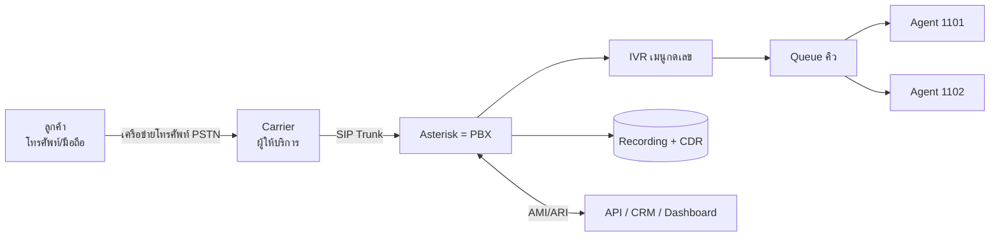

Updated todo list

# พื้นฐาน Call Center สำหรับทำ POC/Demo

## 1. ภาพรวม: ใครคุยกับใคร

Asterisk เปรียบเหมือนสวิตช์บอร์ดดิจิทัลที่ตัดสินใจว่าสายแต่ละสายจะไปที่ไหน

## 2. ศัพท์พื้นฐาน

| คำ | ความหมายแบบง่าย | ใน POC นี้ |
|---|---|---|
| **PBX** | ตู้สาขาโทรศัพท์ เป็นระบบกลางที่รับสาย ต่อสาย โอนสายภายในองค์กร | Asterisk (container `pbx`) |
| **SIP** | ภาษามาตรฐานที่อุปกรณ์ใช้ "ตั้งสาย / รับสาย / วางสาย" (เหมือนการกดโทรและรับสาย) | ตั้งค่าใน pjsip.conf, พอร์ต 5060 |
| **RTP** | ช่องทางส่ง "เสียง" จริงๆ SIP ใช้ควบคุม ส่วน RTP ใช้ขนเสียง | ผ่านไปมาระหว่าง Agent กับ Asterisk |
| **Extension** | เบอร์ภายใน เช่น 1101 | Agent แต่ละคนมีเบอร์ของตัวเอง |
| **SIP Trunk** | "ท่อ" ที่เชื่อม PBX เข้ากับ Carrier เพื่อโทรเข้า/ออกเบอร์จริง | ใน POC ใช้ Carrier จำลอง (container sim) |
| **Softphone** | โปรแกรมโทรศัพท์บนคอม/มือถือ (Zoiper, Linphone) | ใช้แทนเครื่องโทรศัพท์ของ Agent |
| **IVR** | เมนูอัตโนมัติ "กด 1 เคลม กด 2 กรมธรรม์" | extensions.conf |
| **DTMF** | เสียงที่เกิดจากการกดปุ่มเลขบนโทรศัพท์ ซึ่ง IVR ใช้อ่านว่าลูกค้ากดอะไร | ปุ่ม 1/2/0/7 ในหน้า demo |
| **Queue (ACD)** | คิวรอสาย ระบบเลือก Agent ที่เหมาะสมให้ตามกติกา | `q-claim`, `q-policy`, `q-general` |
| **Agent** | พนักงานรับสาย | 1101-1103 (จำลอง) |
| **Hold / MOH** | พักสาย ลูกค้าได้ยินเพลงรอ (Music on Hold) | ปุ่ม Hold |
| **Transfer** | โอนสายให้คนอื่นหรือคิวอื่น | ปุ่ม โอน |
| **Abandon** | ลูกค้าวางสายเองระหว่างรอคิว (เป็นตัวชี้วัดสำคัญ) | KPI "ทิ้งสาย" |
| **CDR** | Call Detail Record คือบันทึกว่าใครโทรหาใคร กี่โมง นานเท่าไร ผลเป็นอย่างไร | แท็บประวัติการโทร |
| **Recording** | ไฟล์เสียงบันทึกการสนทนา | `MixMonitor` ใน dialplan |
| **Screen-pop** | พอ Agent รับสาย หน้าจอ CRM เด้งขึ้นพร้อมข้อมูลลูกค้า | `/mock-crm/screenpop` |
| **Dialplan** | สคริปต์บอก Asterisk ว่า "สายเบอร์นี้เข้ามา ให้ทำอะไรต่อ" | extensions.conf |
| **AMI / ARI** | ช่องทางให้โปรแกรมภายนอกสั่งงานและฟัง event จาก Asterisk | API ของเราใช้ AMI (พอร์ต 5038), ตัวจำลองใช้ ARI |

## 3. Outbound ต้องผ่าน Agent ก่อนไหม

**ไม่จำเป็น** มีสองรูปแบบหลัก:

| รูปแบบ | ลำดับการโทร | เหมาะกับ |
|---|---|---|
| **Manual / Click-to-call** | ระบบโทรหา **Agent ก่อน** เมื่อ Agent รับ แล้วค่อยโทรหาลูกค้า จากนั้นเชื่อมสองสายเข้าหากัน | งานติดตามลูกค้าทีละราย เช่น ตามเบี้ยประกัน |
| **Auto / Predictive Dialer** | ระบบโทรหาลูกค้าจำนวนมากพร้อมกัน **ก่อน** เมื่อลูกค้ารับสายแล้ว ค่อยส่งต่อให้ Agent ที่ว่าง | แคมเปญขาย/ทวงถาม ปริมาณมาก |

POC นี้ทำแบบแรก ส่วนแบบที่สองเป็นงานต่อยอดที่ยังไม่ได้ทำ ซึ่งควรระบุในรายงานว่า Asterisk ทำได้ แต่ต้องพัฒนาเพิ่ม

## 4. Click-to-call คืออะไร

คือปุ่มโทรบนหน้าจอ (CRM หรือ dashboard) ที่ Agent กดแล้วระบบต่อสายให้เอง ไม่ต้องพิมพ์เบอร์

1. Agent กดปุ่มโทรที่เบอร์ลูกค้า
2. API สั่ง Asterisk ผ่าน `POST /calls/originate` (main.py)
3. Asterisk **ให้โทรศัพท์ Agent ดังก่อน**
4. Agent รับ แล้ว Asterisk โทรออกไปหาลูกค้าผ่าน Carrier
5. ลูกค้ารับ จึงเชื่อมสองฝั่งเข้าหากัน แล้วเริ่มบันทึกเสียง

ที่ต้องโทรหา Agent ก่อนเพราะโทรศัพท์ของ Agent เป็นเครื่องที่ควบคุมได้ ทำให้ไม่ต้องรอลูกค้า และ Agent พร้อมคุยทันทีที่ลูกค้ารับ

**ผลการโทรออก** ที่ POC เก็บไว้:
- CONNECTED = ติดต่อได้
- BUSY = สายไม่ว่าง
- NO_ANSWER = ไม่รับสาย
- CANCELLED = Agent ยกเลิกเอง
- FAILED = ขัดข้อง/เบอร์ไม่มี

## 5. ลำดับสายเข้าทั้งเส้นทาง (ตรงกับที่โชว์ใน demo)

1. **ลูกค้าโทรเข้า** Asterisk รับสาย
2. **IVR** เล่นเสียงต้อนรับภาษาไทยและรอลูกค้ากด
3. **เลือกบริการ** กด 1/2/0 ระบบเลือกคิว
4. **Queue** ลูกค้าฟังเพลงรอ ระบบเรียก Agent ที่ว่าง ถ้า Agent ไม่รับหรือปฏิเสธ จะเรียกคนถัดไป
5. **Agent รับสาย** เริ่มบันทึกเสียง CRM ได้รับ screen-pop
6. **Hold / โอน** ตามต้องการ
7. **วางสาย** ระบบเขียน CDR และไฟล์เสียง

**Pause (พัก)** คือ Agent ยังล็อกอินอยู่ แต่ไม่รับสายจากคิวชั่วคราว เช่น พักกินข้าว (ต่างจาก Logout ที่ออกจากคิวไปเลย)

## 6. ส่วนจำลองกับส่วนจริงใน POC

| ส่วนจริง (พิสูจน์ได้) | ส่วนจำลอง |
|---|---|
| Asterisk, IVR, Queue, Hold/Transfer, CDR, Recording, API, event real-time | Agent 1101-1103 (ไม่มีคนจริง), Carrier และลูกค้า (container sim), เนื้อหาเสียงสนทนา |

ปุ่มบนหน้า demo สั่ง Asterisk ตัวจำลองให้ทำตัวเหมือนคนกดโทรศัพท์ ส่วนสิ่งที่ตอบสนองกลับมา (คิว, CDR, event) มาจาก Asterisk จริง

## 7. สิ่งที่ POC ยังไม่ได้พิสูจน์

ควรเขียนเป็น "ข้อจำกัด/ขั้นต่อไป" ในรายงาน:
- **ปริมาณงาน (capacity)** เช่น กี่สายพร้อมกัน ยังไม่ได้ทดสอบโหลด
- **ความทนทาน (HA/Failover)** ถ้า Asterisk ล่มจะเป็นอย่างไร
- **Carrier จริง** ใช้ SIP Trunk จริง, ปัญหา NAT/Firewall, codec
- **Agent บนเว็บ (WebRTC)** ใน POC ใช้ softphone เป็นหลัก
- **Agent Desktop และรายงานเชิงลึก** Asterisk เป็น "แกนโทรศัพท์" ไม่ใช่ผลิตภัณฑ์สำเร็จรูป ต้องสร้างหน้าจอและ Dashboard เอง
- **Predictive dialer, Supervisor (ดักฟัง/กระซิบ), WFM** ยังไม่ได้ทำ
- **ความปลอดภัย** รหัสผ่านใน POC เป็นค่า lab ใช้จริงต้องเปลี่ยน, ใช้ TLS/SRTP, และเก็บไฟล์เสียงตามข้อกำหนด PDPA

## 8. คำถามที่ผู้บริหารมักถาม

- **Asterisk เป็นของฟรีไหม** ใช่ ซอฟต์แวร์ฟรี (โอเพนซอร์ส) แต่ต้องมีทีมดูแลเอง ต่างจากผลิตภัณฑ์เชิงพาณิชย์ที่มี support
- **ต่างจากแพ็กเกจ Call Center สำเร็จรูปอย่างไร** Asterisk ยืดหยุ่นและต่อกับระบบเราได้ลึก แต่ต้องพัฒนาส่วนหน้าจอและรายงานเอง
- **รองรับกี่สาย** ขึ้นกับสเปกเครื่องและ codec ต้องมีผลทดสอบโหลดเพิ่ม (ยังไม่ได้ทำ)

## 9. ข้อแนะนำตอน Demo

- เล่าเป็น "เรื่องของลูกค้า" ก่อนโชว์เทคนิค เช่น "คุณสมชายโทรมาเคลมประกัน"
- ใช้โหมด "กดเอง" แล้วชี้ที่แถบ Flow ทุกครั้งที่ขยับขั้น
- โชว์ให้ครบสองกรณี: สำเร็จ และไม่สำเร็จ (Agent ปฏิเสธ → ส่งต่อคนถัดไป, ลูกค้าวางสายก่อน → ทิ้งสาย)
- เลขท้ายเบอร์ในการโทรออกจำลองกำหนดผล: 1 ติด, 2 ไม่ว่าง, 3 ไม่รับ, 4 ขัดข้อง, 5 เบอร์ไม่มี, 6 รับแล้วอีกฝั่งวาง
- ถ้ามีคนถามว่า "เสียงจริงไหม" ให้ตอบตรงๆ ว่า demo เป็นการจำลองสาย แต่ระบบที่ตอบสนองเป็น Asterisk จริง และสามารถทดสอบเสียงจริงด้วย softphone ได้ (ดู README ส่วน "ทดสอบด้วย Softphone จริง")
